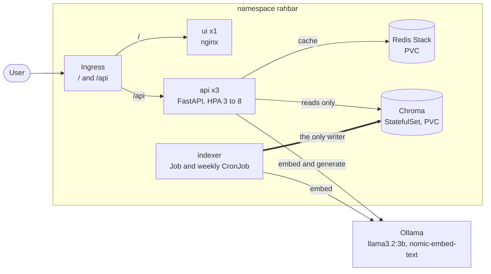

# RAHBAR

**Grounded question answering over university documents, running on Kubernetes.**


A 5th-semester student wants to know whether they can register for a course after failing its prerequisite. The answer is in a clause of a PDF on the university website, superseded last year by a revised policy that is also still on the website. A general-purpose language model will answer anyway, sound completely certain, and describe some other university's rules.

RAHBAR answers **only from a real document corpus** (public FAST-NUCES policies, handbooks and reports), **cites the passage** it used, prefers the **current** version of a policy over the superseded one, and **declines** when the documents do not cover the question. It runs as several objects on a Kubernetes cluster, re-indexes without a redeploy, scales horizontally, survives a deleted pod, and has a CI gate that fails the build when retrieval quality drops.

> Course project, Assignment 02, *Software Construction and Development*. Team of two. Due 8 November 2026.

## Contents

- [Features](#features)
- [Architecture](#architecture)
- [Tech stack](#tech-stack)
- [Quick start](#quick-start)
- [API](#api)
- [Configuration](#configuration)
- [Repository layout](#repository-layout)
- [Documentation](#documentation)
- [Development](#development)
- [Project status](#project-status)
- [Corpus and data](#corpus-and-data)
- [AI assistance](#ai-assistance)
- [Team](#team)

## Features

- **Grounded answers with citations.** Every citation is checked against the passages retrieved for that very request. A citation the retriever never returned is rejected.
- **Honest abstention.** Below a measured relevance floor the system says the corpus does not cover the question, without calling the model.
- **Version-aware retrieval.** Chunks carry `doc_version` and `superseded`; the retriever excludes superseded documents unless the question asks about an older version.
- **Schema-constrained generation.** One Pydantic `Answer` model is both the contract sent to the model and the validator; one retry, then a safe fallback. Users never see a 500 caused by the model.
- **Semantic cache.** Redis Stack vector index, invalidated automatically when the index is rebuilt.
- **Indexing as a Job.** One writer, never at API start-up; re-index with one command and no downtime.
- **Embedding-model pin enforced in code.** If the API and the index disagree on the model, the pod refuses to become ready and logs why.
- **Measured quality.** A golden set, recall@k by question type, citation validity and abstention correctness, enforced as a CI gate.
- **Secure by default.** Non-root containers, read-only root filesystems, dropped capabilities, per-workload service accounts, default-deny network policies.
- **Observable.** JSON logs with a request id, Prometheus metrics, and one log line per request listing the retrieved chunk ids and scores.

## Architecture



Two paths that never share a process: an **indexer** that writes the vector store on demand, and an **API** that only reads it on every question. They are tied together by one embedding-model pin in a single ConfigMap.

The full design, with the network policy matrix, probe wiring, indexing and query sequences, cache design and decision register, is in [`docs/architecture/architecture.md`](docs/architecture/architecture.md). Any difference between the code and that document is recorded in [`docs/architecture/deviations.md`](docs/architecture/deviations.md).

## Tech stack

| Layer | Technology |
| --- | --- |
| UI | Static HTML served by nginx (non-root) |
| API | Python 3.12, FastAPI, Pydantic v2, httpx, prometheus-client |
| Vector store | ChromaDB 1.0.12 (StatefulSet with a PVC) |
| Cache | Redis Stack (vector search) with a PVC |
| Indexer | pdfplumber, pypdf, Tesseract OCR via pytesseract and pdf2image |
| Models | Ollama on the host: `llama3.2:3b` (generation), `nomic-embed-text` (768-dim embeddings) |
| Platform | Docker, minikube (Calico CNI), Kustomize |
| Quality | pytest, ruff, mypy, kubeconform, Trivy, GitHub Actions, kind |

## Quick start

Full guide for Linux, Windows (WSL 2) and macOS: **[`docs/SETUP.md`](docs/SETUP.md)**. The short version, on a machine that already has Docker, minikube, kubectl, Ollama and Python 3.12:

```bash
git clone https://github.com/Zain-Shykh/RAHBAR-Grounded-RAG.git
cd RAHBAR-Grounded-RAG
git checkout dev

make install                 # .venv with api, indexer and dev tools
make test && make lint       # must pass before you do anything else
make dev                     # API with stubs and the UI on http://localhost:8000
```

The cluster path, in the order that works from a clean clone:

```bash
# 1. models on the host (in another terminal, leave it running)
OLLAMA_HOST=0.0.0.0 ollama serve
ollama pull llama3.2:3b && ollama pull nomic-embed-text

# 2. cluster and corpus
make cluster                 # minikube + Calico + metrics-server + ingress
make fetch                   # download the public documents to corpus/raw (not committed)

# 3. build and deploy
make images                  # build api, indexer, ui and load them into minikube
make corpus                  # create the namespace and corpus PVC, copy the documents in
make apply                   # kubectl apply -k k8s/overlays/dev; the indexer Job runs once Chroma is up
kubectl get pods -n rahbar -w

# 4. ask
make ask Q="What CGPA puts a student on academic warning?"
make ask Q="What are the hostel rules?"          # the corpus deliberately lacks this: it declines
```

Hosted LLM mode only: the key is created from the command line and never written to a file.

```bash
export LLM_API_KEY=...
kubectl create secret generic rahbar-secret -n rahbar --from-literal=LLM_API_KEY="$LLM_API_KEY"   # or: make secret
```

Re-index without redeploying:

```bash
kubectl create job --from=cronjob/reindex manual-reindex-1 -n rahbar     # or: make index
```

> Steps 3 and 4 depend on work in progress; see [Project status](#project-status).

## API

| Method and path | Purpose |
| --- | --- |
| `POST /api/ask` | Body `{"question": "..."}` (3 to 500 characters). Returns the answer, citations, retrieved passages, confidence and provider. |
| `GET /healthz` | Liveness. Touches nothing else. |
| `GET /readyz` | Readiness. 200 only if Chroma is reachable, the collection is non-empty, Redis is reachable and the embedding model matches. Otherwise 503 naming the failing dependency. |
| `GET /metrics` | Prometheus text format. |

```json
{
  "request_id": "demo-1",
  "answer": "...",
  "citations": [{"source": "academic-rules-handbook-jun-2026.pdf", "section": "5.4 Academic Warning", "page": 21}],
  "answered_from_context": true,
  "confidence": "high",
  "retrieved": [{"chunk_id": "...", "source": "...", "section": "...", "page": 21, "score": 0.81}],
  "provider": "ollama"
}
```

`answered_from_context: false` means the system declined. Response headers `X-Cache` and `X-Outcome` report cache status and outcome.

## Configuration

All configuration is environment variables, supplied on the cluster by one ConfigMap (`rahbar-config`) and one Secret (`rahbar-secret`), so one image runs everywhere. The important keys:

| Key | Default | Meaning |
| --- | --- | --- |
| `EMBED_MODEL` | `nomic-embed-text` | The embedding pin, read by both the indexer and the API. |
| `LLM_PROVIDER` | `ollama-host` | `stub`, `extractive`, `ollama-host`, `ollama-incluster` or `hosted`. |
| `LLM_MODEL` | `llama3.2:3b` | |
| `TOP_K` | `5` | Passages retrieved per question. |
| `RELEVANCE_FLOOR` | calibrated | Minimum similarity of the best passage, else abstain. |
| `CACHE_THRESHOLD` | calibrated | Minimum similarity for a cache hit. |
| `TEMPERATURE` | `0.2` | Low, because the output is JSON and facts. |
| `CHUNK_SIZE`, `CHUNK_OVERLAP` | measured | Chunking, chosen from three measured configurations. |

The full list is in [`docs/architecture/architecture.md`](docs/architecture/architecture.md#44-configuration). Secrets are never committed: `.env*`, `*secret*.yaml` and keys are gitignored, and the only Secret manifest in Git is a placeholder.

## Repository layout

```
.
├── api/            FastAPI service: reads the index, never writes it
├── indexer/        The Job's image: extract, clean, chunk, embed, store. The only writer.
├── ui/             Chat UI and nginx config
├── corpus/         Document list, fetch script, MANIFEST.md (the documents themselves are not committed)
├── eval/           Golden set, evaluation runner, baselines, CI fixtures
├── k8s/            Kustomize base and overlays (dev, ci, prod)
├── docs/           Architecture, requirements, setup, work plan, ADRs, evidence
├── scripts/        check_submission.py
├── .github/        Workflows and pull request template
├── CONTRIBUTING.md
├── Makefile
└── requirements.txt
```

## Documentation

| Document | What it is |
| --- | --- |
| [`docs/SETUP.md`](docs/SETUP.md) | Install everything and run it, for Linux, Windows (WSL 2) and macOS |
| [`CONTRIBUTING.md`](CONTRIBUTING.md) | Branches, commits, pull requests, ownership |
| [`docs/WORKPLAN.md`](docs/WORKPLAN.md) | Who builds what, in which order, in parallel |
| [`docs/IMPLEMENTATION_PLAN.md`](docs/IMPLEMENTATION_PLAN.md) | Phased build plan and progress log for the RAG lane |
| [`docs/WORKFLOW.md`](docs/WORKFLOW.md) | Spec-driven development workflow used for every phase |
| [`docs/architecture/architecture.md`](docs/architecture/architecture.md) | The architecture: platform and RAG. Single source of truth. |
| [`docs/architecture/deviations.md`](docs/architecture/deviations.md) | Every difference between the build and the architecture |
| [`docs/requirements.md`](docs/requirements.md) | Every requirement extracted from the assignment |
| [`docs/rubric_checklist.md`](docs/rubric_checklist.md) | What to do, what to avoid, what is bonus |
| [`docs/OPEN_DECISIONS.md`](docs/OPEN_DECISIONS.md) | Decisions made and decisions waiting for a human |
| [`docs/CORPUS.md`](docs/CORPUS.md) | The corpus and the seven properties it demonstrates |
| [`docs/PIPELINE.md`](docs/PIPELINE.md) | Indexing and retrieval measurements |
| [`docs/FAILURE-ANALYSIS.md`](docs/FAILURE-ANALYSIS.md) | Breaking the pipeline one stage at a time |
| [`docs/ENGINEERING-NOTES.md`](docs/ENGINEERING-NOTES.md) | Seven engineering questions answered against this code |
| [`docs/adr/`](docs/adr/) | Architecture decision records |
| [`docs/AI-USAGE.md`](docs/AI-USAGE.md) | Which AI tools helped, with what, and what we changed |

## Development

```bash
make test        # api and indexer tests: no cluster, no model, no network
make lint        # ruff and mypy
make dev         # API with stubs and the UI on http://localhost:8000
make check       # submission checker
make             # list every target
```

Work happens on feature branches off `dev`; `main` is protected (pull request, passing CI, one approval). Details in [`CONTRIBUTING.md`](CONTRIBUTING.md). Continuous integration runs lint, tests with coverage, manifest validation, image builds, a Trivy scan and an end-to-end evaluation on a kind cluster against a small fixture corpus; continuous delivery builds images tagged by commit SHA, pushes them to Docker Hub and deploys to an ephemeral cluster.

## Project status

The foundation is in place; the system is being built. This table is updated as work merges.

| Area | State |
| --- | --- |
| Repository, branch protection, tooling, dependency list | Done |
| Corpus: 9 public documents, manifest, seven required properties | Done (PR open) |
| Architecture and requirements | Done |
| Dockerfiles and Kubernetes manifests | Not started |
| Indexing pipeline (extract, clean, chunk, embed, store) | Not started |
| Retriever, providers, cache, validation | Not started |
| Evaluation and CI gate | Not started |
| CI/CD workflows | Not started |

Plan and ownership: [`docs/WORKPLAN.md`](docs/WORKPLAN.md).

## Corpus and data

The corpus is public documents from the FAST-NUCES website (`nu.edu.pk`): policies, handbooks, annual reports, fee and grading pages. To respect the university's content and keep the repository small, **the documents are not committed**. `corpus/sources.yaml` lists each URL, and `corpus/MANIFEST.md` records the size and SHA-256 of every file; `make fetch` downloads them, politely, one at a time, and `python corpus/fetch.py --verify` re-checks the hashes. Nothing behind a login is used. The corpus deliberately omits one topic (hostel rules) so that abstention can be tested honestly. See [`docs/CORPUS.md`](docs/CORPUS.md).

Answers describe the documents as they were downloaded and are not official university advice.

## AI assistance

AI tools were used in this project. What they wrote or shaped, and what we changed afterwards and why, is disclosed in [`docs/AI-USAGE.md`](docs/AI-USAGE.md).

## Team

| | Focus |
| --- | --- |
| [Zain-Shykh](https://github.com/Zain-Shykh) | RAG pipeline, API, indexer, evaluation |
| Ahmad | Kubernetes, UI, CI/CD |

No license has been chosen yet; all rights reserved until one is added.
