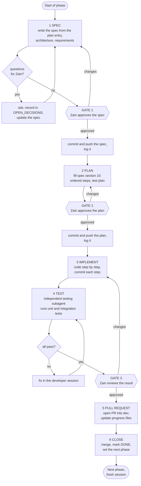

# Development workflow

How a phase of [`IMPLEMENTATION_PLAN.md`](IMPLEMENTATION_PLAN.md) goes from a one-paragraph entry to merged code. Spec-driven, with three human approval gates and an independent test pass.

It is written for the **developer session** (a Claude Code session that writes the code) and for Zain, who drives it. Follow it exactly. If you think a step should change, say so and propose the change; do not skip a step silently.

| | |
| --- | --- |
| Applies to | Zain's RAG lane (phases 1 to 15). Ahmad may reuse it for his own tasks. |
| One phase = | one spec file, one branch, one pull request |
| Spec files | `docs/specs/phase-NN-<slug>.md`, created from [`specs/TEMPLATE.md`](specs/TEMPLATE.md) |
| Progress is logged in | [`IMPLEMENTATION_PLAN.md`](IMPLEMENTATION_PLAN.md) (the only tracker) and the spec file's own sign-off table |

---

## 1. The loop at a glance



Six stages, three gates. Each stage has an entry condition, actions, an exit condition, and a commit. Nothing is merged without passing all three gates.

## 2. Where everything lives

Do not search for these. Use this table.

| Need | File | Read | Write |
| --- | --- | :---: | :---: |
| What phase am I on, what is next | [`IMPLEMENTATION_PLAN.md`](IMPLEMENTATION_PLAN.md) "Current focus" and the dashboard | start of session | end of every stage |
| The phase's objective, scope, acceptance criteria | `IMPLEMENTATION_PLAN.md`, the phase's section | stage 1 | tick boxes at stage 5 |
| The design (what to build and how it fits) | [`architecture/architecture.md`](architecture/architecture.md) | every stage; **re-read the cited sections** | only through a deviation entry |
| Every requirement | [`requirements.md`](requirements.md) | stage 1 | never |
| Deductions to avoid | [`rubric_checklist.md`](rubric_checklist.md) | stages 1 and 5 | tick boxes when proven |
| Choices not yet made, and the ones made | [`OPEN_DECISIONS.md`](OPEN_DECISIONS.md) | stage 1 and whenever unsure | new entries; answers recorded after Zain decides |
| A difference between code and architecture | [`architecture/deviations.md`](architecture/deviations.md) | stage 3 | new entry the same day |
| The phase's spec, plan, test report | `docs/specs/phase-NN-<slug>.md` | all stages | stages 1 to 4 |
| Contracts with Ahmad, hand-offs | [`WORKPLAN.md`](WORKPLAN.md) section 3, `IMPLEMENTATION_PLAN.md` section 3 | stage 1 | hand-off ticks at stage 5 |
| Measured numbers | `IMPLEMENTATION_PLAN.md` section 5 (results register) | any | when measured |
| What the AI did | [`AI-USAGE.md`](AI-USAGE.md) | | end of every phase |
| Starter-kit contracts | `STARTER.md` | stage 1 | never |
| Setup, tools, commands | [`SETUP.md`](SETUP.md), `Makefile` | when needed | only if wrong |
| Branch and commit rules | [`../CONTRIBUTING.md`](../CONTRIBUTING.md) | once | never |

**Precedence when documents disagree:** the assignment (`requirements.md`) > `architecture.md` > the phase spec > `IMPLEMENTATION_PLAN.md` > anything else. If you find a conflict, stop, say which two files disagree, and ask Zain.

## 3. Rules that hold at every stage

1. **Gates are hard stops.** At a gate, stop work, present the artifact, and wait for Zain's explicit approval. Silence is not approval. Do not start the next stage before approval.
2. **Ask, do not guess.** Any unclear spec point, unmade decision, or conflict goes to Zain as a question (section 8). Record it in `OPEN_DECISIONS.md`. A conservative default is allowed only for items that do not block the acceptance criteria, and it is marked `# OPEN: D-0NN` in code.
3. **One phase at a time.** Only the first phase that is not `DONE` is worked on. Never start a later phase "while waiting".
4. **Stay in the lane.** Edit `api/**`, `indexer/**`, `eval/**`, `corpus/**` and this lane's docs. `k8s/**`, `ui/**`, `.github/**` are Ahmad's: put a hand-off in `IMPLEMENTATION_PLAN.md` section 3 instead.
5. **The architecture is fixed.** Differences are logged in `deviations.md` before or with the code, never after.
6. **Tests with the code.** Every behaviour has a test in the same pull request. Tests need no network, no model, no cluster. Never weaken, skip or delete a test to get green.
7. **Never commit** secrets, documents (`corpus/raw/`), models, `.env*`, caches.
8. **Commit and push at every stage boundary** (section 4), so work survives a crashed session and Zain can see it on GitHub. Never push to `main`.
9. **Log progress at every stage boundary** in `IMPLEMENTATION_PLAN.md` (section 5.2 below). The log is how a fresh session knows where things stand.
10. **Use the Docker group workaround** until the desktop is re-logged: `sg docker -c "docker ..."`.

## 4. The stages

### Stage 0. Start of session (every session, every phase)

Do this before anything else, including after `/clear` or a crash.

1. Read `CLAUDE.md` (loaded automatically), then this file if you have not in this session.
2. Read `IMPLEMENTATION_PLAN.md`: **Current focus**, the dashboard, the last 10 lines of the progress log, section 3 (hand-offs).
3. Read the phase's spec file if it exists; its `Stage` field says where you are. Resume from that stage.
4. `git fetch && git status && git log --oneline -5`. Switch to the phase branch (create it from `dev` if this is the start).
5. Check `OPEN_DECISIONS.md` for `OPEN` entries that touch this phase.
6. State to Zain in two lines: the phase, the stage, the next action. Wait for "go" only if the state is unclear.

### Stage 1. SPEC

| | |
| --- | --- |
| Entry | Previous phase merged and marked `DONE`; branch `feat/rag-zNN-<topic>` cut from an up-to-date `dev`; no spec file yet or `SPEC DRAFT`. |
| Output | `docs/specs/phase-NN-<slug>.md` sections 1 to 9, with the header `Stage: SPEC DRAFT`. |

Actions:

1. Copy `specs/TEMPLATE.md` to `specs/phase-NN-<slug>.md`.
2. Read, in this order: the phase section of `IMPLEMENTATION_PLAN.md`; every architecture section it cites (read them, do not rely on memory); the `R-` requirements; the `rubric_checklist.md` items it touches; related `OPEN_DECISIONS.md` entries; the existing code it builds on (read the files, list what exists and what is a `STARTER-TODO`).
3. Write the spec: objective, context with links, in-scope and out-of-scope, interfaces with full signatures, behaviour and design details, **testable** acceptance criteria with ids (start from the plan's boxes and make them concrete), the test strategy and traceability table (every AC maps to at least one test or command), risks.
4. Collect questions (section 8). Put them in spec section 8 and as `OPEN_DECISIONS.md` entries. Present them to Zain together, with your recommendation for each. Update the spec with the answers.
5. When no question is left, **commit the spec** as `Stage: SPEC DRAFT` for review: `docs(spec): phase NN <topic>`, push.
6. Present to Zain: a short summary (objective, scope, AC list, answered and unanswered questions) and the file path.

**GATE 1. Zain approves the spec.** On approval: set `Stage: SPEC APPROVED`, fill the sign-off row, commit `docs(spec): approve phase NN spec`, push, log it. Changes requested: edit, recommit, ask again.

Exit: spec approved and committed.

### Stage 2. PLAN

| | |
| --- | --- |
| Entry | `SPEC APPROVED`. |
| Output | Spec section 10 filled; `Stage: PLAN DRAFT`, then `PLAN APPROVED`. |

Actions:

1. Break the work into small, ordered steps (10.1). Each step: what, files, a **verify** command, a commit message. Prefer slices that each leave `make test` green; put pure functions before network code and tests with or before the code they test.
2. Write the test plan (10.2): which tests are written in which step, which are written first, and what the testing subagent must run in stage 4.
3. Note rollback and risks (10.3) and a time estimate against the work plan (10.4). If the total exceeds the work plan by more than 30%, say so and propose a cut.
4. Commit `docs(plan): phase NN <topic>`, push, present the plan.

**GATE 2. Zain approves the plan.** On approval: `Stage: PLAN APPROVED`, sign-off row, commit `docs(plan): approve phase NN plan`, push, log it.

Exit: plan approved and committed.

### Stage 3. IMPLEMENT

| | |
| --- | --- |
| Entry | `PLAN APPROVED`. |
| Output | The code and tests for every plan step, committed step by step; spec section 11 notes. `Stage: IMPLEMENTING`, then `TESTING`. |

Actions, for each plan step in order:

1. Write or update the test first where the plan says so; then the code. Keep to the spec and the architecture.
2. Run the step's verify command, then `make test && make lint`.
3. Commit with the plan's message (Conventional Commits, `Co-Authored-By` trailer), push.
4. If you must differ from the spec or architecture: stop, write the deviation (`deviations.md`) or, if it is only a spec detail, note it in section 11, tell Zain, and wait if it changes an acceptance criterion or a contract.
5. If the plan itself is wrong, go back to stage 2 with Zain, amend section 10, re-approve. Do not "just proceed".
6. Log one line in `IMPLEMENTATION_PLAN.md` after every couple of steps (not every commit): what works now.

Exit: every plan step done, `make test && make lint` green, `Stage: TESTING`, pushed. Log it.

### Stage 4. TEST (independent)

| | |
| --- | --- |
| Entry | Implementation complete, committed and pushed. |
| Output | Spec section 12 (test report) filled; all acceptance criteria evidenced. |

The developer session does not mark its own work as passing. A **separate testing subagent**, with a fresh context, checks it against the spec.

1. Spawn the testing subagent (for example the `agent-skills:test-engineer` agent, or a general-purpose agent) with the brief in section 6. Give it the spec path, nothing about how the code was reasoned about.
2. It runs: the unit tests, the integration tests the spec names (starting `make dev-services` or Ollama where needed), the verify commands from the plan and `IMPLEMENTATION_PLAN.md`, lint, type check, coverage. It also tries to **break** the behaviour with cases the spec implies but the existing tests may miss, and writes the missing tests.
3. It reports per acceptance criterion: pass or fail with evidence (command and key output). It may add or fix **tests**; it must not change application code. Failures come back as a list.
4. The developer session fixes the failures (stage 3 rules, one commit per fix), then the subagent re-runs. Repeat up to three rounds; after the third failed round stop and ask Zain.
5. Record every round in spec section 12 and commit `test: phase NN <topic> report`, push.
6. Optional but recommended: one `agent-skills:code-reviewer` pass over the diff for correctness, security and drift from the architecture (invariants I-1 to I-17). Fix anything it flags that is real.

**GATE 3. Zain reviews the result.** Present: the AC table with evidence, the test report summary, any deviations, anything surprising, the diff size. On approval: `Stage: READY FOR PR`, sign-off row.

Exit: all ACs pass, Zain approved.

### Stage 5. PULL REQUEST and progress update

1. Tick the phase's acceptance boxes in `IMPLEMENTATION_PLAN.md`, set its status to `DONE`, update the dashboard row and the results register (section 5) for any number measured, update hand-offs (section 3), set **Current focus** to the next phase (`Stage: not started`), add the log lines.
2. Tick the relevant boxes in `rubric_checklist.md` that this phase proves. Update `AI-USAGE.md` (what the AI wrote, what was changed and why, in specifics).
3. Commit `docs(progress): phase NN done`, push.
4. Open the PR into `dev` with the template: link the spec, paste the AC table, say what was tested and how, mention deviations. `gh pr create --base dev`.
5. Put the PR number in the dashboard row (small follow-up commit).

### Stage 6. CLOSE

1. If the change is only in this lane's files and `make test && make lint` are green, merge it (merge commit, delete the branch). Otherwise ask Ahmad to review first (`CONTRIBUTING.md`). Shared files (`Makefile`, `requirements.txt`, `README.md`, `docs/architecture/*`) need his look.
2. `git checkout dev && git pull`. Confirm `make test && make lint` on the merged result.
3. Tell Ahmad about any hand-off that is now ready (message text in the log).
4. End the session. **Start the next phase in a fresh session** (stage 0).

## 5. Progress logging

Every stage boundary produces a log line in `IMPLEMENTATION_PLAN.md` section 4, and the **Current focus** block is rewritten.

### 5.1 Stage names

`SPEC DRAFT` → `SPEC APPROVED` → `PLAN DRAFT` → `PLAN APPROVED` → `IMPLEMENTING` → `TESTING` → `READY FOR PR` → `MERGED`. The spec file header and the **Current focus** block always show the same stage.

### 5.2 Log line format

```
YYYY-MM-DD  PNN  <stage or event>: <what happened>. <evidence: commit, command, file>.
```

Examples:

```
2026-11-05  P01  SPEC APPROVED: spec for container images approved, 2 questions answered (D-035, D-036). docs/specs/phase-01-container-images.md @ a1b2c3d
2026-11-05  P01  TESTING round 1: 2 failures (indexer runs as root, api healthz 404). Fixed in 9f8e7d6.
2026-11-05  P01  MERGED: PR #4. rahbar-api and rahbar-indexer build and run non-root. H-1 told to Ahmad.
```

### 5.3 Current focus block

```
Phase:        NN  <title>
Stage:        <one of the stage names>
Branch:       feat/rag-zNN-<topic>
Spec:         docs/specs/phase-NN-<slug>.md
Next action:  <one concrete next step>
Waiting on:   Zain (gate or question) | Ahmad (hand-off) | nothing
Last updated: YYYY-MM-DD HH:MM
```

### 5.4 What the dashboard status means

| Dashboard status | Meaning |
| --- | --- |
| `NOT STARTED` | No spec file yet. |
| `IN PROGRESS` | Any stage from `SPEC DRAFT` to `READY FOR PR`. The stage is in Current focus and the spec header. |
| `BLOCKED` | Cannot continue; the log line says by what. |
| `DONE` | Merged to `dev`, acceptance boxes ticked. |
| `DROPPED` | Cut line; the log says why. |

## 6. The testing subagent

### 6.1 Brief to give it

Use this text, filling the placeholders. Do not add your own explanation of how the code works; the point is an independent check.

```
You are the independent tester for RAHBAR phase NN: <title>.

Spec: docs/specs/phase-NN-<slug>.md. Read it fully, including section 6 (acceptance criteria)
and section 7 (test strategy). Also read docs/architecture/architecture.md sections cited in
the spec, and docs/rubric_checklist.md section A (deductions).

Do the following in the repository at <path> on branch <branch>:
1. Run `make test` and `make lint`. Run coverage: `cd api && ../.venv/bin/pytest -q --cov=app` (and for
   indexer / eval where relevant).
2. Run every integration test and verify command the spec names. If a service is needed
   (`make dev-services`, Ollama at localhost:11434), start it. Docker needs `sg docker -c "..."`.
3. For each acceptance criterion AC-n, decide PASS or FAIL and give evidence: the command and
   the key lines of its output. A criterion with no evidence is a FAIL.
4. Try to break the behaviour: edge cases, bad input, a dependency down, concurrency, the
   things a spec implies but the tests may not cover. Add tests for gaps you find
   (tests only, in the existing test locations, following their style).
5. Check the invariants I-1 to I-17 in architecture.md section 0.2 that this phase could
   violate (for example: no Chroma write in api/, /healthz touches nothing, no secret in the diff).

Rules:
- You may create or edit test files and the test report. You must NOT edit application code
  (api/app, indexer/pipeline, eval/run_eval.py), configuration or docs other than the report.
- Tests must need no network, no model and no cluster unless the spec marks them integration.
- Do not weaken or delete existing tests.

Report format (reply, and I will paste it into spec section 12):
- Round N, date, branch, commit.
- Table: AC id | PASS/FAIL | evidence.
- Extra tests added (file, name, what they cover).
- Defects found: id, what, how to reproduce, which AC or invariant it breaks, severity.
- Commands run and coverage numbers.
- Verdict: PASS (all AC pass, no open defect) or FAIL.
```

### 6.2 After it reports

- Paste the report into spec section 12 (one row per round plus the detail).
- A defect is fixed in the developer session as a separate commit referencing the AC. Do not argue a failing test away: if you believe the test is wrong, say why to Zain and let him decide.
- Rerun the subagent. Three failed rounds stop the phase and go to Zain.

### 6.3 What counts as passing

All acceptance criteria PASS with evidence; `make test` and `make lint` green; coverage not below the stated target (60% for `app` is the floor, the spec may set higher); no open defect that breaks an invariant or a deduction item; the tester's added tests committed.

## 7. Spec, plan, implementation: what each is for

| Document part | Answers | Typical length | Mistake to avoid |
| --- | --- | --- | --- |
| Spec (sections 1 to 9) | **What** and **why**: behaviour, interfaces, acceptance | 1 to 3 pages | Describing steps instead of behaviour; vague criteria ("works well") |
| Plan (section 10) | **How** and **in what order**: steps, files, verify commands, tests | Half to one page | A plan too large to verify step by step; no test plan |
| Implementation | The code | | Drifting from the spec; skipping tests; unlogged deviation |
| Test report (section 12) | **Does it meet the spec**, with evidence | As needed | "All tests pass" without commands or output |

A good acceptance criterion is observable and binary: "`/readyz` returns 503 and the body names `embed_pin` when `EMBED_MODEL` differs from the collection metadata", not "readiness works".

## 8. Asking Zain questions

Questions are part of the workflow, not an interruption. Ask early in stage 1, and later only when something blocks.

- **How:** use the question tool (`AskUserQuestion`) when the choices are discrete: 2 to 4 options, a recommended first option labelled "(Recommended)", each with a one-line consequence. Use plain text for open questions. Batch related questions in one message (up to four).
- **What to include:** the decision in one sentence, why it matters to this phase, the options, your recommendation and the reason.
- **Record:** every question that is not trivial becomes an `OPEN_DECISIONS.md` entry (`D-0NN`, status `OPEN`, area, related ids, options, recommendation, what it blocks). After Zain answers, fill **Decision** and **Decided on**, set the status, and update the spec.
- **Do not ask** about things the architecture, requirements or earlier decisions already settle. Quote the document instead.
- **Do ask** when: two documents conflict; an assumption in architecture section 9 turns out false; a contract with Ahmad would change; a result of a measurement forces a choice (floor, threshold); anything affecting a deduction item.

## 9. Deviations and surprises

| Situation | Action |
| --- | --- |
| Code must differ from `architecture.md` | `deviations.md` entry (template inside), tell Zain, pause if S1 or S2; absorb or revert later. |
| Spec detail was wrong or incomplete | Note in spec section 11; if an acceptance criterion changes, back to gate 1 with Zain. |
| Plan was wrong | Back to stage 2, amend, gate 2 again. |
| Assumption false (architecture section 9) | Deviation entry plus tell Zain at once; the watch-list in `deviations.md` shows the likely fallback. |
| A starter-kit contract must change | ADR entry plus `OPEN_DECISIONS.md`, as `STARTER.md` requires. |
| Tool or environment breaks | Log in the progress line, try the documented workaround (`SETUP.md` troubleshooting), then ask. Do not fight a tool for more than 30 minutes. |
| Bug found in an earlier merged phase | New branch `fix/<topic>` off `dev`, test first, small PR; note it in the log and in the affected phase's section. |

## 10. Quality gates summary

| Gate | Zain checks | Evidence presented |
| --- | --- | --- |
| 1 Spec | Right thing, right boundaries, answerable and testable criteria, questions resolved | Spec file, AC list, answered questions |
| 2 Plan | Steps small and verifiable, order sensible, test plan present, estimate sane | Spec section 10 |
| 3 Result | Every AC has evidence, nothing surprising, deviations acceptable, diff size reasonable | AC table, test report, commit list |

Before opening the PR, run the checklist in `rubric_checklist.md` section A for the items this phase could affect, and `python3 scripts/check_submission.py` for the sections it touches.

## 11. Context hygiene (why the documents are split this way)

- `CLAUDE.md` is short and always loaded. It holds only what every task needs and points here. Heavy detail lives in the documents, read on demand.
- One phase per session. At the end of stage 6 start a fresh session; the state is in files, not in conversation.
- Read the sections you need (architecture is long). Use the section numbers in the plan and the spec; do not read whole documents "just in case".
- The spec and the plan are the working memory of a phase. If the session is lost mid-phase, the spec header's `Stage`, the Current focus block and the git log recover it in a minute.
- The testing subagent starts with only the spec and the repository. That independence is the point.

## 12. Short prompts for Zain

Because the workflow carries the detail, prompts to the developer session can be short.

| You type | The session does |
| --- | --- |
| `Start the next phase.` | Stage 0, then stage 1. |
| `Continue.` | Stage 0, resume at the recorded stage. |
| `Spec approved.` | Gate 1 sign-off, commit, push, log, start stage 2. |
| `Plan approved.` | Gate 2 sign-off, commit, push, log, start stage 3. |
| `Spec changes: ...` / `Plan changes: ...` | Edit, recommit, ask again. |
| `Run the tests.` | Stage 4 with the testing subagent. |
| `Approved, open the PR.` | Gate 3 sign-off, stage 5, then stage 6 when told to merge. |
| `Merge it.` | Stage 6. |
| `Where are we?` | Report phase, stage, last log lines, what is blocked. |
| `Log a decision: D-0NN is ...` | Record the answer and update the affected spec. |

## 13. Suggested improvements built into this workflow

Compared with a plain "spec, plan, code, test" loop, these were added on purpose:

1. **Traceability.** Each acceptance criterion maps to a named test or command (spec section 7), so "done" is checkable, not a feeling.
2. **Independent tester with a written brief** (section 6) and a rule that it cannot change application code; this removes the author marking their own homework.
3. **Third gate before the PR**, so Zain sees evidence, not just a claim.
4. **State in files, resume anywhere.** Stage in the spec header, Current focus and the log; any session can resume.
5. **Questions are recorded** in `OPEN_DECISIONS.md`, so a decision survives the conversation.
6. **Commit at every stage** (spec, plan, code steps, test report), so the PR history shows the process and nothing is lost.
7. **Fresh session per phase**, which keeps context small and quality high.
8. **A deviation protocol** that makes drift visible instead of silent.
9. **Optional code-reviewer pass** against the architecture invariants before the gate.
10. **Short prompts** (section 12), because the workflow is the memory.

Things deliberately not added, to keep four days workable: separate spec PRs, formal sprint ceremonies, a second reviewer for every phase. If Phase 1 shows the overhead is too high, collapse gates 1 and 2 into one for small phases and note it here.

## 14. Per-phase checklist (copy into the spec if useful)

- [ ] Stage 0: state read, branch ready, open decisions checked
- [ ] Spec written; questions asked and recorded; spec committed and pushed
- [ ] **Gate 1** approved; logged
- [ ] Plan written; committed and pushed
- [ ] **Gate 2** approved; logged
- [ ] Steps implemented with tests; each committed and pushed; `make test && make lint` green
- [ ] Deviations logged
- [ ] Testing subagent PASS; report in spec section 12; committed
- [ ] **Gate 3** approved
- [ ] Progress files updated (plan: ACs, status, dashboard, hand-offs, results, log; rubric ticks; AI-USAGE)
- [ ] PR opened with spec link and AC table; PR number in dashboard
- [ ] Merged; `dev` verified; Ahmad told of hand-offs; session ended
