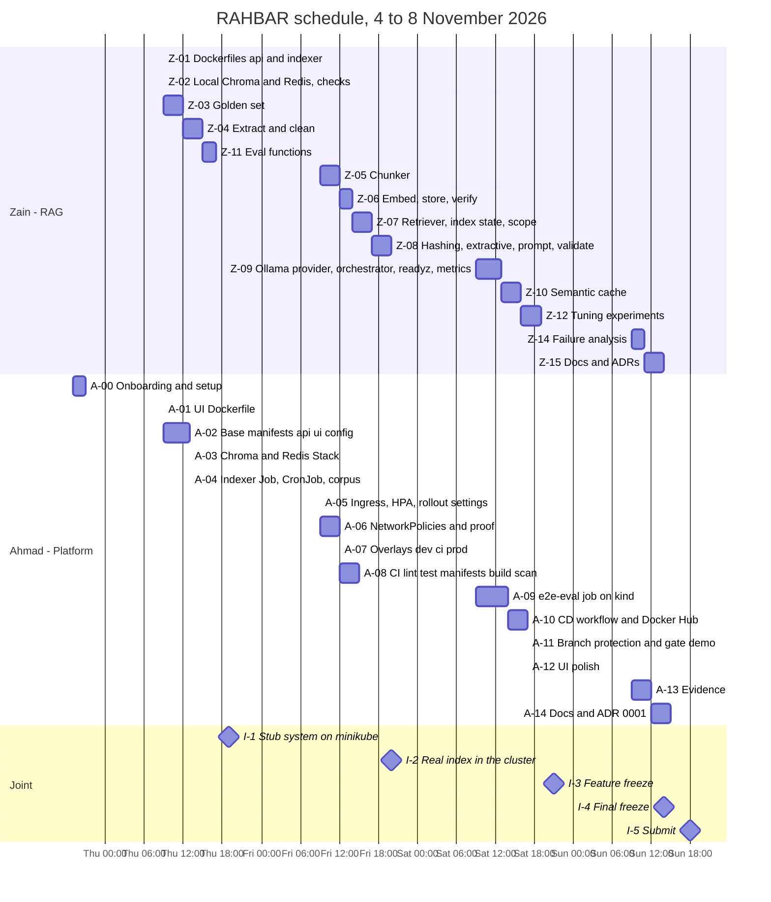
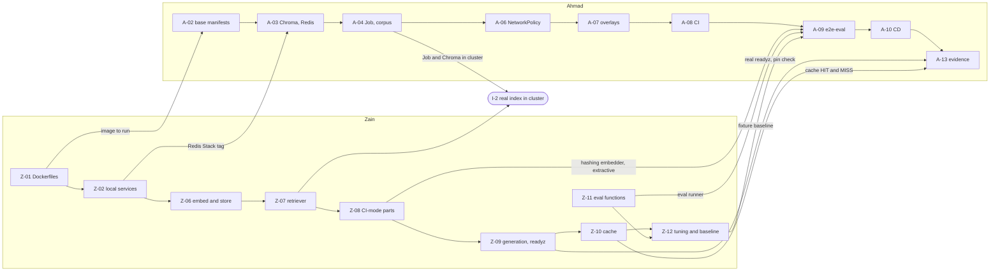

# Work plan

Two people, two lanes, built so that neither waits for the other.

| | |
| --- | --- |
| Start | Wednesday 4 November 2026 (evening) |
| Feature freeze | Saturday 7 November, 21:00 |
| Final freeze | Sunday 8 November, 14:00 |
| Target submission | Sunday 8 November, 18:00 (deadline 23:59 PKT; late work is not accepted) |
| Companions | [`architecture/architecture.md`](architecture/architecture.md), [`requirements.md`](requirements.md), [`rubric_checklist.md`](rubric_checklist.md), [`OPEN_DECISIONS.md`](OPEN_DECISIONS.md), [`../CONTRIBUTING.md`](../CONTRIBUTING.md) |

Hour estimates assume AI-assisted coding, including reading, reviewing and fixing what the assistant writes. They are planning numbers, not promises. Re-estimate at each sync.

## 1. Lanes

| | **Zain: RAG lane** | **Ahmad: Platform lane** |
| --- | --- | --- |
| Builds | The indexing pipeline, the retriever, providers, cache, validation, abstention, the readiness and pin check, metrics, evaluation, tuning | Kubernetes manifests, Kustomize overlays, NetworkPolicies, the UI image, CI and CD workflows, branch protection, evidence |
| Owns | `api/**` including `api/Dockerfile`, `indexer/**` including its Dockerfile, `eval/**`, `corpus/**` | `ui/**`, `k8s/**`, `.github/**`, `docs/evidence/**` |
| Writes (docs) | `PIPELINE.md`, `FAILURE-ANALYSIS.md`, ADR 0002 chunking, 0003 cache store, 0004 provider and data governance, engineering notes Q5 | ADR 0001 indexer-as-Job, engineering notes Q1, Q2, Q3, Q4, Q6, README apply order, `SETUP.md` upkeep |
| Local tools | Python, Ollama, local Chroma and Redis Stack in Docker | minikube, kubectl, kustomize, kubeconform |
| Needs from the other lane | An image build to run in-cluster (from himself), the manifests only for integration | Images (from Zain), a real `/readyz`, fixtures baseline and the CI-mode components (from Zain) |

**Why this is parallel.** The two lanes meet only at eight small contracts (section 3). Each side builds against the contract with a stand-in, never against the other's unfinished work. Section 6 lists the stand-in for every dependency.

## 2. Schedule

### 2.1 Day by day

| Day | Zain | Ahmad | End of day check |
| --- | --- | --- | --- |
| **Wed 4 (evening)** | Merge the setup PR once Ahmad has set up. Agree sync times. | A-00 onboarding: follow `docs/SETUP.md`, `make test`, `make lint`, `make cluster`, Ollama. | Ahmad: `make test` green and `make cluster` Ready. |
| **Thu 5** | Z-01 Dockerfiles first (they unblock Ahmad), Z-02, Z-03, Z-04, Z-11 | A-01, A-02, A-03, A-04: the whole system on **stubs** in minikube | **I-1** at about 19:00: `RETRIEVER=stub`, `--dummy` index, 3 api pods Ready, UI loads through the Ingress |
| **Fri 6** | Z-05, Z-06, Z-07, Z-08: full indexing, retrieval, CI-mode components | A-05, A-06, A-07, A-08: ingress, HPA, NetworkPolicy, overlays, CI | **I-2** at about 20:00: real Job indexes the real corpus in-cluster, api on `RETRIEVER=chroma`, `/readyz` honest |
| **Sat 7** | Z-09, Z-10, Z-12: generation, readiness, cache, tuning, baseline | A-09, A-10, A-11, A-12: e2e-eval, CD, protection, UI | **I-3** at 21:00: feature freeze. Gate works, CD green, baseline committed. |
| **Sun 8** | Z-14, Z-15, last tuning fixes | A-13, A-14, final evidence and README | **I-4** 14:00 final freeze, `make check`, **I-5** submit by 18:00 |

Saturday is the crunch day. If Friday slips, apply the cut line in section 7 on Friday night, not on Saturday night.

## 3. The eight contracts

These are the only places the lanes touch. They are frozen from today. Changing one needs a [`deviations.md`](architecture/deviations.md) entry and a message to the other person, because the other lane is building against it right now.

| # | Contract | Provider | Consumer | Definition |
| --- | --- | --- | --- | --- |
| C-1 | **Images** | Zain (api, indexer), Ahmad (ui) | Ahmad | Build contexts `api/`, `indexer/`, `ui/`. Names `rahbar-api`, `rahbar-indexer`, `rahbar-ui`, tag `dev`. Config by environment variables only. api: port 8000, `uvicorn app.main:app`. indexer: no port, `python -m pipeline.run [--dummy]`. ui: port 8080. Non-root user, exec-form CMD, pinned bases, `.dockerignore` (architecture 4.12). |
| C-2 | **Config keys** | Ahmad (ConfigMap) | Zain (Settings) | The key table in architecture 4.4. Zain adds a new key to `Settings` only if it is in that table; if a new one is needed, tell Ahmad and add it to the table in the same PR. |
| C-3 | **Probes** | Zain | Ahmad | `/healthz` returns 200 `{"status":"alive"}` and touches nothing. `/readyz` returns 200, or 503 with `{"status":"not_ready","failed":[...],"checks":{...}}` (architecture 4.8). Until Z-09 lands the kit stub says "ready", which is fine for stub bring-up. |
| C-4 | **Indexer Job** | Zain | Ahmad | Reads `CORPUS_DIR` (default `/corpus`) containing documents plus `_index.json`. Waits for Chroma (120 s) and Ollama (60 s). Exit 0 success, 1 failure, 2 stage not implemented. `--dummy` writes three fake chunks with model `dummy-768`. Needs write access only to `/tmp`. |
| C-5 | **Data services** | Ahmad | Zain | Chroma `chromadb/chroma:1.0.12` at `chroma:8000`, heartbeat `/api/v2/heartbeat`. Redis Stack at `redis:6379`. Zain runs the same images locally with `make dev-services`. |
| C-6 | **Evaluation** | Zain | Ahmad | `python eval/run_eval.py --api <url> --host rahbar.local --golden <file> --baseline <file> --out <file>`. Exit 0 pass, 1 gate failed, 2 not implemented. Fixtures: `eval/fixtures/golden.fixture.yaml` and `baseline.fixture.json` (architecture 5.13.4). |
| C-7 | **Metrics and logs** | Zain | Ahmad (evidence) | Metric names in architecture 4.14 and the `answered` log line. Ahmad reads them for `docs/evidence/` and for `kubectl logs` checks. |
| C-8 | **Ollama host** | each person's laptop | Ahmad (NetworkPolicy), Zain | `OLLAMA_URL=http://host.minikube.internal:11434`. Models `llama3.2:3b`, `nomic-embed-text`. The NetworkPolicy `ipBlock` is the host IP from `minikube ssh "grep host.minikube.internal /etc/hosts"`. CI runs without Ollama (CI-mode). |

## 4. Zain: RAG lane

The step-by-step build plan for these tasks, with acceptance criteria and the progress log, is [`IMPLEMENTATION_PLAN.md`](IMPLEMENTATION_PLAN.md). **Zain's status is tracked there only.**

Priority: **P0** required and graded or a deduction if missing, **P1** required but can be thin, **P2** bonus.

| ID | Task | Main files | Depends on | Est | Prio | Done when |
| --- | --- | --- | --- | ---: | :---: | --- |
| Z-01 | **Dockerfiles** for api and indexer, with `.dockerignore`. Multi-stage api, indexer with `tesseract-ocr` and `poppler-utils`. Non-root, pinned bases, exec-form CMD. | `api/Dockerfile`, `api/.dockerignore`, `indexer/Dockerfile`, `indexer/.dockerignore` | none | 1.5 h | P0 | `docker build` works for both; `docker run rahbar-api:dev` serves `/healthz` as non-root with a read-only root filesystem; `make images` loads them (needs A-01 for the ui line). **Merge first: it unblocks A-02.** |
| Z-02 | **Local data services and assumption checks.** `make dev-services` (Chroma 1.0.12 and Redis Stack in Docker). Verify architecture assumptions A-2, A-3 (collection rename, batch size) and risk R-02 (Redis Stack non-root, tag to pin). Tell Ahmad the verified image tags. | `Makefile`, notes in `docs/architecture/deviations.md` if something differs | none | 1.5 h | P0 | A script proves create, add, delete, rename on Chroma; `FT.CREATE` and a KNN query run on the Redis Stack image; the exact Redis Stack tag is posted for Ahmad (A-03). |
| Z-03 | **Golden set** `eval/golden.yaml`, at least 15 questions (8 ordinary, 2 version, 2 exact term, 2 must-abstain hostel, 1 injection) with relevant `{source, section}` taken from the documents, **before any tuning**. | `eval/golden.yaml` | corpus downloaded | 3 h | P0 | Passes the checker's golden section; every `relevant` item was found by reading the document, not by running the retriever. Section names are re-verified against the chunker output after Z-05. |
| Z-04 | **Extract and clean.** PDF text with layout kept, OCR for pages under 30 characters, HTML tables as rows, Markdown for fixtures, header and footer removal, cleaning rules. Unit tests on small inputs. | `indexer/pipeline/extract.py`, `clean.py`, `verify.py`, tests | none | 3 h | P0 | The 9 real documents extract; the scanned policy and the 2023 rules yield text through OCR; a table keeps one row per line; tests green. |
| Z-11 | **Eval functions.** `recall_at_k`, `citation_validity`, `summarise`, `gate` with the matching rule in architecture 5.13.2, `X-Outcome` reporting, results file. | `eval/run_eval.py`, tests | Z-03 helpful, not required | 2 h | P0 | `make eval-fixtures` against `make dev` runs and gates (stub numbers are fine); exit codes 0, 1, 2 are correct; unit tests for each function. **Also needed by A-09.** |
| Z-05 | **Chunker.** Heading detection, sections to paragraphs to sentences, word-based size and overlap, stable ids, five metadata fields, tables never split. | `indexer/pipeline/chunk.py`, tests | Z-04 | 3 h | P0 | Metadata on every chunk; no chunk crosses a document; definitions in the Student Handbook GenAI section stay whole at the shipped size; ids are stable across runs. |
| Z-06 | **Embed and store.** Ollama batch embedding with retries, `hashing-bow-768` embedder, stage-and-swap store with collection metadata (`embed_model`, `dimension`, `index_id`, `doc_versions`), `run.py` waits, exit codes. | `indexer/pipeline/embed.py`, `store.py`, `embedding/`, `run.py`, tests | Z-02, Z-05 | 2 h | P0 | Running `python -m pipeline.run` against local Chroma and Ollama produces a live collection with correct metadata; a forced failure leaves the old collection untouched; the Job exit codes are right. |
| Z-07 | **Retriever and index state.** Embedding module (Ollama and hashing, parity test with the indexer copy), `ChromaRetriever` with `where` filter, `scope.py`, `index_state.py` (polling, pin check, handle re-resolution), score as `1 - distance`. | `api/app/embedding/`, `retrieval/chroma.py`, `services/scope.py`, `services/index_state.py`, tests | Z-06 | 3 h | P0 | Against the real local index, a version question returns the 2026 handbook first and a "2023" question returns the 2023 rules; swap during queries does not error. |
| Z-08 | **Prompt, validation, extractive provider.** `prompt.py` with delimiters, `validate.py` (parse, citation check, canned fallback), `extractive.py`, provider interface extension (`GenerationResult`, errors, `hint`). | `api/app/services/prompt.py`, `validate.py`, `providers/llm/base.py`, `extractive.py`, tests | Z-07 | 3 h | P0 | Unit tests: injection chunk not obeyed with the stub, fabricated citation rejected, invalid JSON twice gives the canned fallback, extractive abstains with no passage. **Needed by A-09 on Saturday morning.** |
| Z-09 | **Generation, orchestration, readiness, metrics.** `ollama.py` with `format=` schema and options, `answer.py` pipeline (floor, retry, fallback, headers), `/readyz` with pin check and dimension check, all metrics and the `answered` log line. | `api/app/providers/llm/ollama.py`, `services/answer.py`, `routes/health.py`, `routes/ask.py`, `routes/metrics.py`, tests | Z-08 | 4 h | P0 | End to end locally: a cited answer on a real question, an abstention on hostel, `/readyz` 503 on a changed `EMBED_MODEL` with the exact log line, metrics visible at `/metrics`. |
| Z-10 | **Semantic cache** on Redis Stack: per-`index_id` index, scope tag, write rules, invalidation by `index_id`, `X-Cache` header. | `api/app/services/cache.py`, tests | Z-02, Z-09 | 3 h | P0 | Second identical question is a `HIT`; abstentions and fallbacks are never stored; after re-indexing the old entry is gone; Redis down degrades to a miss. |
| Z-12 | **Tuning experiments.** Three (size, overlap) runs on recall@5; relevance-floor calibration; cache thresholds (at least three, record the false hit); write `eval/baseline.json`, `results.json`, `eval/fixtures/baseline.fixture.json`. | `eval/*`, ConfigMap values (hand to Ahmad), `docs/PIPELINE.md` | Z-09, Z-10, Z-11 | 3 h | P0 | The three-row table with numbers; the shipped values chosen from it; baselines committed; recall by type reported. |
| Z-14 | **Failure analysis.** Break four stages one at a time (suggested A, C, E, F) and record symptom, diagnosis, stage, remedy, metric. | `docs/FAILURE-ANALYSIS.md` | Z-12, A-04 | 2 h | P0 | Four sections each with the number that would have shown it; reverted after each experiment. |
| Z-15 | **Docs and ADRs.** `PIPELINE.md`, ADR 0002 (chunking), ADR 0003 (cache store), ADR 0004 (provider and data governance, including the interface extension), engineering notes Q5, `AI-USAGE.md` entries. | `docs/PIPELINE.md`, `docs/adr/*`, `docs/ENGINEERING-NOTES.md`, `docs/AI-USAGE.md` | Z-12 | 3 h | P0 | Every section filled with real numbers and file or line references; no `STARTER-TODO` left. |

Zain total: about 37.5 h.

## 5. Ahmad: Platform lane

| ID | Task | Main files | Depends on | Est | Prio | Done when | Status |
| --- | --- | --- | --- | ---: | :---: | --- | :---: |
| A-00 | **Onboarding.** Follow `docs/SETUP.md` end to end on WSL 2: tools, `make install`, `make test`, `make lint`, `make dev`, Ollama with both models, `make fetch`, `make cluster`. Fix `SETUP.md` where it was wrong or unclear. | `docs/SETUP.md` | none | 2 h | P0 | `make test` and `make lint` green; `make dev` shows the stub chat; `kubectl get nodes` Ready; `minikube ssh "curl http://host.minikube.internal:11434/api/tags"` answers. | [ ] |
| A-01 | **UI Dockerfile.** `nginxinc/nginx-unprivileged` pinned, `index.html`, `nginx.conf` as the main config, non-root. | `ui/Dockerfile`, `ui/.dockerignore` | none | 0.5 h | P0 | Image serves the UI on 8080 with a read-only root filesystem and `emptyDir` on `/tmp`. | [ ] |
| A-02 | **Base manifests (stub mode).** Namespace, ServiceAccounts, ConfigMap with all keys and justification comments, placeholder Secret (not in kustomization), api and ui Deployments with 3 probes, resources, security contexts, rollout settings, `preStop`, four Services, `kustomization.yaml`. | `k8s/base/*` | Z-01 for the image; manifests can be written and `kubeconform`-checked before it lands | 4 h | P0 | `kubectl apply -k` gives 3 api pods and the ui, all in `rahbar`, all with requests and limits; `kustomize build \| kubeconform -strict` passes. | [ ] |
| A-03 | **Chroma and Redis Stack.** Chroma StatefulSet with `volumeClaimTemplates` and its probes, Redis Stack Deployment with PVC `cache-data`. Verify non-root with read-only root (risks R-01, R-02). | `k8s/base/chroma-statefulset.yaml`, `redis.yaml` | Z-02 (Redis Stack tag) | 2.5 h | P0 | Both pods Ready with PVCs bound; data survives `kubectl delete pod`; any relaxed security setting is logged in `deviations.md`. | [ ] |
| A-04 | **Indexer Job, CronJob, corpus delivery.** Job (`restartPolicy: OnFailure`, `backoffLimit`), CronJob `reindex` weekly with the same template, `corpus-data` PVC, `make corpus` and the `make apply` pre-step that deletes a finished Job. | `k8s/base/indexer-job.yaml`, `reindex-cronjob.yaml`, `corpus-pvc.yaml`, `Makefile` | A-03, Z-01 | 2.5 h | P0 | `--dummy` Job completes; `kubectl create job --from=cronjob/reindex x` works; `make corpus` copies the nine files; api pods turn Ready. | [ ] |
| A-05 | **Ingress, HPA, rollout settings.** Ingress `rahbar.local` (`/` ui, `/api` api, timeout annotation), HPA 3 to 8 at 70% CPU. | `k8s/base/ingress.yaml`, `hpa.yaml` | A-02 | 1.5 h | P0 | `make ask` works through the Ingress; `kubectl get hpa` shows a real percentage, not `<unknown>`. | [ ] |
| A-06 | **NetworkPolicies and proof.** Default deny, DNS egress, the allow list in architecture 4.6, Ollama `ipBlock`. | `k8s/base/networkpolicy.yaml`, `k8s/overlays/dev` | A-04, A-05 | 3 h | P0 | System still works under deny; from a `ui` pod a connection to `chroma:8000` fails while from `api` it succeeds; output saved for evidence. | [ ] |
| A-07 | **Overlays.** `dev` (minikube), `ci` (kind, fixtures ConfigMap, `hashing-bow-768`, `extractive`, no Ollama egress), `prod` (registry images by SHA). | `k8s/overlays/{dev,ci,prod}/kustomization.yaml` | A-06 | 2.5 h | P0 | `kustomize build` of all three passes `kubeconform -strict`; `dev` applies on minikube. | [ ] |
| A-08 | **CI part 1.** `ci.yml` with `lint`, `test` (60% coverage), `manifests`, `build` (no push), `scan` (Trivy HIGH and CRITICAL with fix), `permissions`, pinned actions. | `.github/workflows/ci.yml` | A-07 | 3 h | P0 | A pull request runs all five jobs; a deliberately broken manifest fails `manifests`. | [ ] |
| A-09 | **CI part 2: e2e-eval.** kind, ingress-nginx, `ci` overlay with images loaded, Job on the fixtures, wait for rollout, run `eval/run_eval.py` with the fixture golden set and baseline, enforce the gate. | `.github/workflows/ci.yml` | A-08, Z-08, Z-11, Z-12 (fixture baseline) | 5 h | P0 | The job passes on `dev`; a change that breaks retrieval turns it red. Build the skeleton earlier with a smoke question only, then switch on the gate when Z-11 and the baseline land. | [ ] |
| A-10 | **CD.** `cd.yml`: `test`, then `build-push` (`needs: test`, Docker Hub, `${{ github.sha }}`), then `deploy` (`needs: build-push`, kind, rollout status, smoke test through the Ingress). Create the Docker Hub token and the GitHub Secrets. | `.github/workflows/cd.yml`, repo secrets | A-08, Docker Hub account | 3 h | P0 | A run on `main` is green; Docker Hub shows images tagged by SHA; no `:latest` anywhere. | [ ] |
| A-11 | **Branch protection and gate demo.** Add the CI job names as required checks, one approval, no direct pushes, admin enforcement. Open a PR that fails the gate, screenshot the blocked merge, fix it, screenshot green. | repo settings, `docs/evidence/` | A-08, A-09 | 1.5 h | P0 | Screenshots saved; settings screenshot saved. | [ ] |
| A-12 | **UI polish.** Check the UI against abstentions, fallbacks, errors, cache chip, long answers, mobile width; fix defects; version label in the UI for the rollout demo. | `ui/index.html` | A-05 | 1.5 h | P2 | Each state renders sensibly; the version string changes visibly between two image tags. | [ ] |
| A-13 | **Evidence.** `kubectl top pods` for every workload (and justify requests and limits), `get endpoints` with 3 or more IPs, `get hpa`, `rollout set image / status / undo`, pod deletion while asking, `EMBED_MODEL` mismatch with `0/1 READY` and the log line, manual re-index, cache HIT then MISS after re-index, NetworkPolicy proof. | `docs/evidence/*` | Z-09, Z-10, A-06, A-11 | 3 h | P0 | At least five evidence files, each with the command and its output. | [ ] |
| A-14 | **Docs.** ADR 0001 in his own words, ARCHITECTURE pointer, README apply order checked on a clean clone, engineering notes Q1, Q2, Q3, Q4, Q6, `AI-USAGE.md` entries. | `docs/adr/0001-*.md`, `README.md`, `docs/ENGINEERING-NOTES.md`, `docs/AI-USAGE.md` | A-13 | 3 h | P0 | Every answer cites a real file and line; README steps work on a clean clone. | [ ] |

Ahmad total: about 39 h.

## 6. Dependencies and stand-ins

Where one lane needs the other, the dependency and what to do while waiting.

| Needs | From | When it lands | Stand-in until then |
| --- | --- | --- | --- |
| Images to run | Z-01 (Zain) | Thu 10:30 | Ahmad writes and validates manifests with `kubeconform` and `kubectl apply --dry-run=client`, and does A-01. |
| Redis Stack tag verified | Z-02 (Zain) | Thu 12:00 | Ahmad writes `redis.yaml` with the tag as a single line to change. |
| An honest `/readyz` | Z-09 (Zain) | Sat 13:00 | The kit stub says ready: fine for stub bring-up and rollout checks. The pin demonstration waits. |
| `hashing-bow-768` and `extractive` | Z-06, Z-08 (Zain) | Fri evening | Ahmad builds the e2e job skeleton: kind, ingress-nginx, `ci` overlay, Job, rollout wait, smoke call with the stub provider. Switches on the gate later. |
| Fixture baseline | Z-12 (Zain) | Sat afternoon | Skeleton job with the gate step commented as a `TODO(A-09)`; remove it when the file exists. |
| `eval/run_eval.py` | Z-11 (Zain) | Thu 20:00 | `curl` smoke test. |
| Manifests for integration | A-02 to A-04 (Ahmad) | Thu evening | Zain uses `make dev-services` and local `make dev`. He never needs the cluster to code. |
| ConfigMap value changes (floor, threshold, chunk size) | Z-12 (Zain) | Sat | Zain tells Ahmad the values; Ahmad edits `configmap.yaml`. One owner for the file. |
| Real corpus in the cluster | A-04 (Ahmad) | Thu 18:00 | Zain indexes locally with `CORPUS_DIR=corpus/raw`. |

If you are blocked for more than 30 minutes, say so and switch to the stand-in. Never edit the other lane's files to unblock yourself without telling them.

## 7. Cut line

If time runs short, cut from the bottom of this list first. Never cut anything marked "deduction".

| Order | Cut | Cost of cutting |
| --- | --- | --- |
| 1 | `hosted` provider, `ollama-incluster`, hybrid retrieval (none are planned) | Bonus only |
| 2 | A-12 UI polish | None to marks |
| 3 | Cache thresholds: try two values instead of three | Small |
| 4 | Failure analysis: exactly four stages, no extras | Small |
| 5 | Extra golden questions beyond 15 | Small |
| 6 | Gate screenshots: produce one clean red/green pair, nothing more | Small |
| Never | Anything that avoids a deduction: no secrets in Git, Job not startup indexing, citations checked, abstention 100%, PVCs, ClusterIP data tier, requests on every container, `needs:` and SHA tags, namespace `rahbar`, README order that works, no push to `main`, pinned embedding model | Deductions of 4 to 20 each |

## 8. Integration milestones

| | When | What both people do together | Pass condition |
| --- | --- | --- | --- |
| **I-1** | Thu about 19:00 | Run the stub system in minikube. | `kubectl get pods -n rahbar` all Ready; the UI loads at `http://rahbar.local`; `make ask` returns the stub answer; deleting an api pod causes no failed request. |
| **I-2** | Fri about 20:00 | Switch the ConfigMap to `RETRIEVER=chroma` and `EMBED_MODEL=nomic-embed-text`, run the real indexer Job in the cluster, restart the api. | Api pods become Ready only after the index exists; `make ask` returns a retrieved, cited stub-generated answer. |
| **I-3** | Sat 21:00 | Feature freeze. Run `make eval` on the real corpus and the CI e2e on the fixtures. | Gate green on both; baselines committed; cache HIT/MISS shown; pin mismatch demonstrated. After this, only fixes and documentation. |
| **I-4** | Sun 14:00 | Final freeze. `make check` clean, evidence complete, README order tested on a clean clone. | `scripts/check_submission.py` has no failures; both people can explain every part. |
| **I-5** | Sun by 18:00 | Merge `dev` to `main` through the pull request. CD run green. Submit on Google Classroom: repo URL, successful `cd.yml` run, Docker Hub images link, `eval/results.json`, `eval/baseline.json`. | Submission confirmed. Leave the evening as buffer. |

The `dev` to `main` pull request must be opened by Saturday night so that CD has a full day to be fixed if it fails.

## 9. Git flow for this plan

- One task, one branch off `dev`, for example `feat/rag-z05-chunker`, `feat/k8s-a06-networkpolicy`. Pull request into `dev`.
- Merge your own lane's files yourself after `make test && make lint`. Anything across lanes or in shared files needs the other person's look first (full rules in [`../CONTRIBUTING.md`](../CONTRIBUTING.md)).
- Shared files and who touches them when:
  - `Makefile`: Zain adds `dev-services`; Ahmad adds `corpus`, fixes `apply`, `images`. Small PRs, merge quickly.
  - `k8s/base/configmap.yaml`: Ahmad only. Zain asks.
  - `docs/architecture/*`: both, through a pull request the other approves.
  - `README.md`: Ahmad owns the apply-order section, Zain the API and configuration sections.
- `dev` to `main`: open early, merge when green and approved. `main` receives nothing else.

## 10. Documentation ownership

| Document | Writer | Reviewer |
| --- | --- | --- |
| `docs/CORPUS.md` | Zain (done) | Ahmad |
| `docs/PIPELINE.md` | Zain | Ahmad |
| `docs/FAILURE-ANALYSIS.md` | Zain | Ahmad |
| `docs/ENGINEERING-NOTES.md` | Q1, Q2, Q3, Q4, Q6 Ahmad; Q5, Q7 Zain (Q7 is whoever lost the most time) | each other |
| `docs/adr/0001-indexer-as-job.md` | Ahmad (in his own words) | Zain |
| `docs/adr/0002` chunking, `0003` cache store, `0004` provider and data governance | Zain | Ahmad |
| `docs/AI-USAGE.md` | both, each their own part | each other |
| `docs/evidence/*` | Ahmad (Zain adds his metric and log captures) | Zain |
| `README.md`, `docs/SETUP.md` | Ahmad upkeep, Zain API sections | each other |
| `docs/architecture/*`, `docs/OPEN_DECISIONS.md` | both | each other |

## 11. Risks and contingencies

| Risk | Likelihood | If it happens |
| --- | --- | --- |
| Both laptops run minikube and Ollama at once and swap | High | Close other apps; `minikube stop` when not testing; Zain develops against local Docker services, not minikube. |
| Redis Stack or Chroma image will not run non-root | Medium | Z-02 and A-03 check it on Thursday. Log a deviation, relax the narrowest setting, or fall back to plain Redis with app-side cosine (OPEN_DECISIONS D-001 option B). |
| OCR quality hurts exact-term recall | Medium | Documented in PIPELINE.md as a measured loss; do not hide it. |
| Real-corpus eval is slow on a laptop | High | Keep generation `LLM_MAX_TOKENS` at 512; evaluate sequentially; run the golden set once per experiment, not once per tweak. |
| CI e2e takes too long or is flaky | Medium | Fixtures only, three small documents; cache images in the workflow; `kind` with a single node. |
| Ahmad's WSL setup eats Wednesday night | Medium | `SETUP.md` WSL section; fall back to a single shared cluster session over voice call for I-1. |
| Merge conflicts in shared files | Low | Ownership table; small PRs; pull `dev` daily. |
| Docker Hub account or token not ready | Low | Create it on Thursday (A-10 prerequisite), not Saturday. |
| PR #1 not merged | Low | It is approved. Merge it before any new feature branch is cut from `dev`. |

## 12. Definition of done (any task)

1. It does what its "Done when" says, and you ran it.
2. `make test` and `make lint` pass.
3. New logic has a test with no network.
4. Matches the architecture, or a `deviations.md` entry exists.
5. Docs and `AI-USAGE.md` updated.
6. Pull request merged into `dev`; status box ticked in this file in the same PR.

## 13. Progress tracking

Zain's status lives in [`IMPLEMENTATION_PLAN.md`](IMPLEMENTATION_PLAN.md). Ahmad ticks the status boxes in section 5 in the same pull request that finishes each task. Anything dropped by the cut line is marked `[-]` with a one-line reason.
