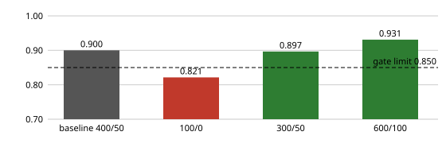

# RAHBAR: RAGOps for a grounded question-answering system

**Assignment 03 (RAGOps), Software Construction and Development**

| Group member | Roll number |
| --- | --- |
| Muhammad Zain | 24i-3126 |
| Ahmad Jamal | 24i-3006 |

Repository: the submitted branch of the RAHBAR project (`README.md`, section "Assignment 03", has one command per part A to F). Every number below comes from a committed file under `eval/results/`, `docs/evidence/`, `traces/` or `docs/specs/`; `python scripts/check_numbers_a3.py` checks that mechanically.

## 1. Figure 3 of the paper: what each stage does here

The system is RAHBAR from Assignment 02 (FastAPI, ChromaDB, Redis, Ollama `llama3.2:3b` and `nomic-embed-text`) on minikube. Assignment 03 adds the data lifecycle, three-level tests, a release gate, traces and a controlled release.

| Stage (paper) | What we do | Files | What is missing |
| --- | --- | --- | --- |
| Ingestion | Documents and a manifest `_index.json` land in the inbox volume `corpus-data`; extraction with OCR; Batch B (12 planted documents) ingested as a Job | `corpus/fetch.py`, `corpus/batch_b/`, `indexer/pipeline/extract.py`, `make ingest-batch` | Only a file inbox; no pull connectors, change-data-capture or watchers |
| Verification | Four checks per document (quality, completeness, recency, uniqueness incl. near-duplicate by embedding, threshold 0.97), failures quarantined with a reason, report per run | `indexer/pipeline/verification/`, `eval/results/neardup-calibration-20261120T221945Z.json` | **Consistency** (contradiction detection) is not built; the injected instruction passes by design and is caught only at query time |
| Update data lake | Registry, quarantine, archive of each version by hash, reports on volume `lake-data`; incremental update by copy-forward, then swap; `restore` rolls back with 0 embeddings | `indexer/pipeline/registry.py`, `incremental.py`, `restore.py` | One volume, no off-cluster backup, no archive retention rule |
| Update retrieval sources | One vector collection per index, written only by the indexer Job; metadata `doc_version`, `superseded`; retrieval filters superseded documents | `indexer/pipeline/store.py`, `api/app/retrieval/chroma.py` | One source type; no knowledge graph, no second retriever |
| Offline testing | Golden set (52 questions in the file, 50 in the measured runs) and one command running module, component and end-to-end levels, with noise, two-run stochasticity and the release gate | `eval/golden.jsonl`, `eval/suite/`, `eval/gate.yaml` | No LLM judge (faithfulness is token overlap, D-115); synthetic questions not yet reviewed by a person |
| Live testing | One JSON trace per query on stdout and on a volume; trace tool that rebuilds the prompt; metrics endpoint; summary Job; injection rail | `api/app/services/trace.py`, `scripts/trace_tool.py`, `scripts/trace_report.py` | No alerting, no automatic feedback from monitoring to re-indexing (only a weekly CronJob) |
| Coverage checking | 40 live-style queries against the golden set by embedding similarity, exit code 1 below target | `eval/suite/coverage.py`, `eval/coverage.yaml`, `eval/live_queries.jsonl` | Only query coverage; retrieval, generation and vocabulary coverage not done; target not reached (section 3, E) |

## 2. Table 2 of the paper: the five qualities

| Quality | What we measure | Threshold | Evidence |
| --- | --- | --- | --- |
| Adaptability | A pipeline change (chunk size and overlap) is a new collection, scored by the same suite, released by one command; changed documents re-embed only their own chunks | gate rules below | `docs/evidence/r7-decision.md`, `eval/results/compare-cand-*.txt`, `a2-unchanged-run.txt` |
| Monitorability | Degradation: recall@5, MRR, faithfulness, abstention, citation validity, p95 latency, per candidate against the baseline; data change: the verification report and registry | recall@5 no more than 0.02 below baseline; MRR 0.03; faithfulness 0.05; abstention not below baseline; citation validity at least 0.95; p95 at most 300 s | `eval/gate.yaml`, `eval/results/gate-*.txt` |
| Observability | Per query: top-1 similarity, abstention, cache, per-stage latency, injection flags; rail action in the trace | n/a (reported) | `docs/evidence/a3/d2-trace-report-job.txt`, `f-metrics.txt`, `d1-trace-record.txt` |
| Traceability | Trace holds collection name and index id, embedding version, chunk ids with document versions and scores, filter, prompt hash; the tool rebuilds the prompt and verifies the hash | hash must match | `docs/evidence/a3/d2-trace-tool.txt`, `r9-trace-after-undo.txt` |
| Reliability | Rolling update with `maxUnavailable: 0`; resource requests and limits measured; the vector store written by one Job only | 0 non-200 during release | `docs/evidence/a3/r9-release.txt`, `docs/evidence/f5-resources.txt`, `r8-netpol.txt` |

## 3. Results, parts A to F

### A. Verification and incremental update

On Batch B the report (screenshot A1) checked 13 documents: 6 indexed, 6 quarantined, 1 superseded. Failures per check: uniqueness 3, completeness 3, quality 2, recency 1 (`a1-verification-report.txt`). Every planted problem except the injected instruction was found with a reason. Real corpus on the cluster: 9 of 9 documents pass, 980 chunks, 1396 s (`f2-ingest-job-logs.txt`). A second run on the unchanged corpus embeds 0 chunks, copies 0, does not swap and keeps the index id (A2). After Batch B the index held 1010 chunks (30 embedded, 980 copied forward, `a2-batch-b-ingest.txt`); the delete test then removed one document (4 chunks), leaving 1006. Deleting a document leaves 0 chunks under it and embeds 0 (`a2-delete-no-orphans.txt`); `make restore` makes the older fee page current again with 0 embeddings (`a2-restore.txt`). The near-duplicate threshold 0.97 sits between the largest cosine of distinct documents (0.9379) and the planted near-duplicate (0.9998).

### B. Three-level evaluation (live index, Batch A and B, 50 questions, screenshot B)

| Level | Metric | Value |
| --- | --- | --- |
| Module (embedding) | paraphrase mean / unrelated mean / gap | 0.791 / 0.525 / 0.266 |
| Module | median embed time per chunk; determinism (max abs diff) | 285.3 ms; 0 |
| Component (39 answerable) | recall@3, recall@5, MRR, nDCG@5 | 0.795, 0.795, 0.756, 0.766 |
| Component, typos | recall@3, recall@5, MRR, nDCG@5 | 0.769, 0.795, 0.676, 0.706 |
| End to end | faithfulness (overlap mean; share supported at 0.6) | 0.879; 0.900 |
| End to end | abstention correctness (11 unanswerable); false abstention rate | 0.909; 0.256 |
| End to end | citation validity (39 citations); expected-text hit rate | 1.000; 0.714 |
| End to end | latency p50 / p95 | 54.4 s / 181.7 s |

Source: `eval/results/suite-20261121T021833Z-baseline-ab.json`. Two identical seeded runs on Batch A: every retrieval and answer-quality metric identical, 1 of 27 answer texts differs, p95 latency 184.46 s versus 113.14 s (`stochasticity-20261121T003255Z.json`). Retrieval is deterministic; generation and latency are not.

### C. Change experiment and release decision

Change: chunk size and overlap (baseline 400/50). Three candidates, each a full re-index into its own collection, served by `api-candidate`, scored by the same suite and gate.

| Candidate | Chunks | recall@5 | MRR | Faithfulness | Abstention | p95 s | Gate |
| --- | --- | --- | --- | --- | --- | --- | --- |
| baseline 400/50 | 1006 | 0.7949 | 0.7564 | 0.9000 | 0.9091 | 181.7 | |
| 100/0 | 1428 | 0.7949 | 0.7308 | 0.8214 | 1.0000 | 128.7 | **FAIL** (exit 1) |
| 300/50 | 1041 | 0.7949 | 0.7436 | 0.8966 | 1.0000 | 188.6 | PASS |
| 600/100 | 977 | 0.7949 | 0.7564 | 0.9310 | 0.9091 | 179.8 | PASS |

{ width=62% }

**Decision: reject 100/0, release 600/100** (`docs/evidence/r7-decision.md`). 100/0 fails on faithfulness (0.9000 to 0.8214, limit 0.85); in live probes on its collection one question was answered wrongly (41 instead of 19) and one abstained (`r9-bad-release.txt`). 600/100 passes every rule; its gain is one answer in 30, inside the measured noise of two answers, so we claim no regression and a possible small gain. **Honesty note:** the faithfulness rule was changed after we saw the 100/0 result. The first limit was an absolute 0.70 chosen from the 0.833 Batch A baseline; with it, 100/0 passed 6 of 6 rules (`gate-cand-100-0-initial-limits.txt`). We replaced it by "baseline minus 0.05" because the baseline moved to 0.900 and one answer is worth 0.033 to 0.037 of the rate (in the two identical runs 1 of 27 answer texts differed, the rate itself did not move). The new limit is justified by measured noise, but it was set after the result, so the 100/0 failure is not an independent blind test. Both outputs are committed. The production release of 600/100 is left to Zain; the release mechanics were recorded on 300/50 (part F).

### D. Traces and metrics

A full trace record is screenshot D1; the tool rebuilds the exact prompt and checks its hash (D2). The trace summary Job over 61 queries (`d2-trace-report-job.txt`): top-1 similarity median 0.798 (min 0.611, max 0.908), abstention rate 0.311, fallback 0.000, injection flags 0, p50 / p95 total latency 54286.7 / 154291.6 ms, of which generation 54001.3 / 153991.5 ms and retrieval 19.1 / 23.8 ms. Generation is the cost; retrieval is not.

**Root cause from a trace only** (`d5-root-cause.md`): question g19 abstained although recall was fine. In its trace the floor passed (0.8073 against 0.7), the filter was `superseded=false`, the rails dropped nothing, and the prompt carried the right chunks (EVIDENCE 3 and 4 hold the "5 courses" rule). The model answered `answered_from_context: false`. Cause: the model ignored evidence that was in the prompt; not the chunks, the version or the filter.

### E. Coverage and data drift

Threshold 0.72 from the embedding calibration: 0.5250 + 0.75 x 0.2663 = 0.7247 (`e2-coverage-calibration.txt`); target 0.85 (the paper's example). **Before** (E1): 12 of 40 live queries covered, share 0.300, exit code 1. **After** adding 16 golden questions (E2): 27 of 40, share 0.675, in-domain share 0.429 to 0.857, still exit code 1. We did not push further: 13 queries stay uncovered, 9 of them off-domain or about topics the corpus does not contain and 4 in-domain ones just under the threshold (0.699 to 0.719); 5 of the 16 added questions are unanswerable ones, and adding more of them would raise the number without testing the system more (`e2-uncovered-topics.md`).

**Data drift** after ingesting Batch B (`e3-data-drift.md`, `drift-20261121T083232Z.json`). Like for like on the 27 old questions: recall@5 0.8095 to 0.7143, false abstention 0.1905 to 0.3333, answered 18 to 15. Three questions changed outcome. Two (q07, g22, tuition refund) are marked abstained now (for g22 the stored answer text even says that none of the fee is refunded, an unsupported statement that the abstention flag does not hide): the answer lived only in `fee-structure-page.html`, which the new `b10-fee-structure-amendment-2027.md` supersedes and which has no refund clause, so retrieval correctly skips the old page and the user loses the fact. One (q06) fell back with identical retrieval: generation variance, not drift. The version question g33 is answered "Rs 28,500" from the 2027 amendment. g34 also abstains with no cause analysed. The injected document (`b11`) is retrieved for g31 (recall@5 1.0) and the rail drops the whole chunk, so the answer abstains: on the rebuilt cluster the trace shows `injection_scan` with action `dropped_passage` (`e3-injection-rail-live.txt`). The attack fails, and the legitimate rule in the same chunk is lost: a deliberate false abstention. One more change is not drift: g32 abstains because the A2 delete test had removed its source document before that index was built.

### F. Kubernetes

Screenshots F1 to F5. Objects: Deployment `api` (3 replicas, HPA), StatefulSet `chroma`, Redis, Jobs `indexer` and `eval`, CronJob `reindex`, persistent volumes for corpus, lake, traces, eval results, Chroma and Redis, NetworkPolicies, ConfigMap `rahbar-gate`. Eval Job: `kubectl apply -f k8s/eval-job.yaml` exits with the gate status (F3). **ConfigMap edit** (F4): the p95 limit changed from 300 to 0.001, `make gate-config`, same image, the Job flips from Complete to Failed. **Release** of `rahbar_cand` by rolling update: 64 requests during the update, all 200 (`r9-release.txt`). **Bad release** of the rejected collection, then `kubectl rollout undo` and `rollout status` succeed; a new trace shows the previous collection and the embedding version (F5, `r9-trace-after-undo.txt`). Measured peaks and chosen values (`f5-resources.txt`): api memory peak 71 Mi, request 100m / 80Mi, limit 500m / 128Mi; chroma peak 104 Mi, limit 384Mi; indexer peak 469 Mi, limit 768Mi; eval Job peak 24 Mi, limit 64Mi.

**Fresh-cluster rehearsal** (`r11-fresh-cluster-rehearsal.txt`). We ran `minikube delete`, then only the steps of `k8s/README.md`. The real corpus indexed again to 9 documents and 980 chunks in 1399.7 s (the same as the first cluster); the second `make index` embedded 0 chunks; a 5-question smoke eval Job set a baseline and a second Job passed the gate (6 of 6 rules; a smoke run says nothing about quality); Batch B was ingested (6 indexed, 6 quarantined); 3 unseen synthetic documents (12 chunks) were ingested in a 24 s Job and a question about them was answered with a correct citation; `/readyz` 200 with 3 of 3 api pods Ready. It exposed three defects, all fixed: a 120 s wait for the helper pod that is too short when images must be pulled, a first indexer Job that fails on the still empty inbox (expected, now documented), and a smoke run whose first five questions had no unanswerable one, so the gate failed closed on a missing metric.

## 4. Short answers

**(a) Which check caught most, which problem escaped?** Uniqueness and completeness tie at 3 failures each (quality 2, recency 1). The injected instruction in `b11` passes all four checks; it is caught only by the query-time rail. A second escape is semantic: the 2027 amendment, a correct newer version, silently drops the refund clause of the page it supersedes, and nothing noticed (it surfaced as q07 and g22 in drift). A consistency check comparing the old and new version for removed facts, and running the injection scan at ingestion, would catch these.

**(b) Module fine, later level not?** Yes. The embedding gap is a healthy 0.266 and retrieval for g19 found the right chunks, yet the end-to-end answer abstained (D, root cause): the model ignored evidence in its prompt. Likewise recall@5 is 0.795 while the false abstention rate is 0.256: a good module score hides generation failures.

**(c) Archive or delete old versions?** We archive: every version is kept by hash in `lake-data` and the old page is flagged `superseded`, not deleted from the index until it is removed. Deleting a document removes its chunks (0 orphans); restore is possible only while the archive holds the old file, so deleting the archive would make rollback of a data change impossible and would leave trace records pointing at a version nobody can read. We did not test deleting the archive.

**(d) Metric we trust least?** Faithfulness, because it is token overlap with the cited text, not a judge. For q06 the answer "No" (correct in substance) scores overlap 0.0 and an expected-text miss. It also decided the release, with a limit set after we saw results. Latency p95 is the other weak one (184.46 s against 113.14 s on identical runs).

**(e) Hardest paper idea?** Testing generation without a judge, and the paper's feedback loop from monitoring to update. We replaced the LLM judge with deterministic overlap and hand-checked abstention and citation validity, and replaced a continuous pipeline by Jobs, one CronJob and a gate that runs on demand. Archived versions stay in the lake, while the index only flags them. The paper's fifth verification check, consistency, is not built.

**(f) Which object carries which responsibility?** Job `indexer` and CronJob `reindex`: the only writer to Chroma and the lake. NetworkPolicy `chroma-ingress` plus the api having no write code (checked with a grep): nothing else writes to the vector store. PVC `lake-data`: quarantine, archive and registry survive restarts. PVC `traces-data`: trace files. ConfigMap `rahbar-gate`: release thresholds. Job `eval`: its exit status is the release decision. Deployment `api-candidate` with its own Service: the candidate collection. Deployment `api` with `maxUnavailable: 0` and `revisionHistoryLimit: 10`: release and rollback.

## 5. Contributions, AI statement and honest gaps

| Member | Contribution |
| --- | --- |
| Muhammad Zain | All of Assignment 03: design, code, runs on the cluster, evidence, this report (written with the AI assistant below) |
| Ahmad Jamal | No work on Assignment 03. `git log` shows 2 non-merge commits by him against 283 by Zain on this branch (6 commits by him on all branches, merges included); all are Assignment 02. R3-LOG-6 (commits from both members) is met only in that thin sense |

**AI statement.** Claude Code (a Sonnet model) wrote most of the code, tests, scripts, manifests and this report under Zain's direction; every number was produced by committed scripts and runs. Zain approved the plans and decisions (`docs/OPEN_DECISIONS.md`, `docs/AI-USAGE.md`); nothing the AI wrote has been reviewed by Ahmad.

**Gaps, stated plainly.**

1. The golden set has 18 human questions (from Assignment 02) and 32 synthetic ones; none of the synthetic questions is reviewed by a person (8 are needed, `eval/HUMAN_TODO.md`), so `golden --check` fails on that point.
2. No LLM judge; the requirement on judge agreement does not apply (D-115).
3. Coverage after is 0.675, below the 0.85 target.
4. Consistency, the paper's fifth verification check, is not built.
5. The golden labels of q07 and g22 point at a superseded document and need a human decision.
6. One Ollama model on CPU: each answer takes about a minute, so each comparison rests on a single run of 50 questions. Two version-aware questions (g51, g52, naming the 2026-27 fee page) were added to `eval/golden.jsonl` after the final result files; they are not in the measured runs (so the file has 52 questions, the runs 50).
